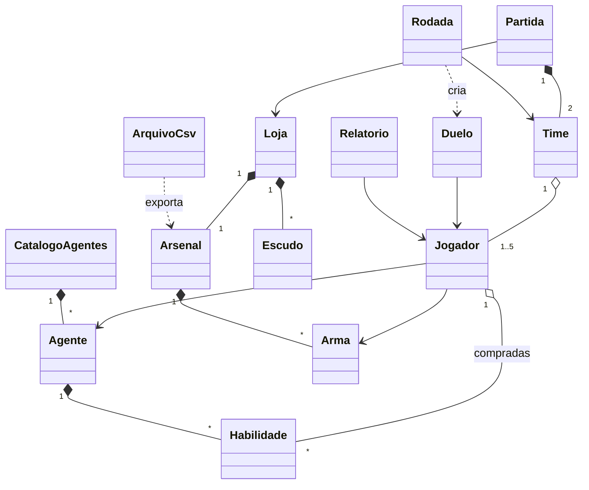

[README.md](https://github.com/user-attachments/files/33583810/README.md)
# Valorant-RPG-Simulador-Tatico-de-Partidas# Valorant RPG — Simulador Tático de Partidas

Simulador em turnos de partidas de **Valorant** no terminal, feito em **Java** com Programação Orientada a Objetos. O sistema gerencia o arsenal de armas, os agentes e suas habilidades, a economia de créditos entre rodadas e os duelos 5x5, e gera um relatório de desempenho ao fim da partida.

> Projeto livre da disciplina de Programação Orientada a Objetos (Java).

---

## Sumário

1. [Nome do projeto](#nome-do-projeto)
2. [Integrantes](#integrantes)
3. [Descrição do problema](#descrição-do-problema)
4. [Funcionalidades](#funcionalidades)
5. [Principais classes](#principais-classes)
6. [Regras de negócio](#regras-de-negócio)
7. [Tecnologias utilizadas](#tecnologias-utilizadas)
8. [Instruções para configuração](#instruções-para-configuração)
9. [Instruções para execução](#instruções-para-execução)
10. [Exemplos de utilização](#exemplos-de-utilização)
11. [Testes automatizados](#testes-automatizados)
12. [Utilização de IA](#utilização-de-ia)

---

## Nome do projeto

**Valorant RPG — Simulador Tático de Partidas**

---

## Integrantes

<!-- Preencham com os nomes reais e o que cada um fez -->

| Integrante | Função | Responsabilidade |
|---|---|---|
| Isac Lopes| Desenvolvedor | No geral, a equipe se juntou para fazer os métodos, classes e o github |
| Henrique Dutra | Desenvolvedor |  |
| Manoel Folha | Desenvolvedor |  |
| Natan Brasil | Documentação |  |

Sugestão de divisão por parte do sistema (ajustem para o que cada um realmente fez):

| Parte do sistema | Pacote / classes |
|---|---|
| Modelo do domínio | `model` — `Agente`, `Arma`, `Escudo`, `Habilidade`, `Jogador`, `Time` |
| Economia e loja | `service` — `Loja`, `Arsenal`, `CatalogoAgentes` |
| Combate e partida | `service` — `Duelo`, `Rodada`, `Partida` |
| Relatórios e arquivos | `service.Relatorio`, `io.ArquivoCsv` |
| Interface no terminal | `ui.Menu`, `App` |
| Testes e documentação | `src/test/java`, `README.md` |

---

## Descrição do problema

No Valorant, boa parte das rodadas é decidida antes do primeiro tiro: **quanto gastar, em qual arma e em quais habilidades**. Jogadores iniciantes costumam gastar mal os créditos e não sabem comparar o custo-benefício das armas. Treinar isso dentro do jogo é lento, porque uma partida dura cerca de 40 minutos.

O **Valorant RPG** reproduz as principais regras do jogo (economia, loja, escudos, habilidades, tiro na cabeça, abates) numa simulação rápida em turnos, no estilo RPG, e mostra no final quem teve o melhor desempenho.

**Possíveis usuários:**

- **Jogadores iniciantes**, que querem entender a economia e o valor de cada arma.
- **Treinadores de times amadores**, que querem testar composições de agentes e estratégias de compra.
- **Game designers / balanceamento**, que podem cadastrar armas, editar preços e exportar o arsenal para uma planilha.

**Simplificações assumidas:** a simulação não inclui spike (plantar e desarmar), lados atacante/defensor nem prorrogação. Cada rodada termina quando um dos times é eliminado, e a partida termina ao primeiro time chegar a 5 rodadas.

---

## Funcionalidades

| Operação | Como aparece no sistema | Onde está no código |
|---|---|---|
| Cadastrar | Cadastrar nova arma | `Arsenal.cadastrarArma` |
| Consultar | Consultar arma ou agente por nome | `Arsenal.buscarPorNome`, `CatalogoAgentes.buscarPorNome` |
| Editar | Editar o preço de uma arma | `Arsenal.editarPreco` |
| Listar | Listar armas, agentes e escudos | `Arsenal.listar`, `CatalogoAgentes.listar`, `Loja.listarEscudos` |
| Remover | Remover arma (exceto a Classic) | `Arsenal.removerArma` |
| Associar objetos | Comprar arma, escudo e habilidade para o jogador; montar times | `Loja.comprarArma/Escudo/Habilidade`, `Time.adicionarJogador` |
| Pesquisar por atributo | Pesquisar armas por preço máximo | `Arsenal.buscarPorPrecoMaximo` |
| Ordenar | Armas por preço ou dano; ranking de jogadores | `Arsenal.listarOrdenado`, `Relatorio.ranking` |
| Regras de negócio | Economia, loja, combate e efeitos | `Rodada`, `Loja`, `Jogador`, `Duelo`, `Habilidade` |
| Indicadores | Total, média, maior/menor, K/D | `Relatorio` |
| Relatórios | Relatório da partida no terminal | `Relatorio.gerar` |
| Exportar dados | Exportar o arsenal de armas em CSV | `ArquivoCsv.exportarArmas` |

### Menu principal

```
1 - Jogar uma rodada       (inicia uma partida: rodadas até um time chegar a 5 vitórias)
2 - Gerenciar armas        (listar, pesquisar, ordenar, cadastrar, editar preço, remover, exportar CSV)
3 - Consultar agentes
4 - Relatório da última partida
0 - Sair
```

### Fluxo principal (processo completo)

```
Partida → Rodada → Compras (Loja) → Duelos → Pagamento → Placar → Relatório
```

1. `Partida` monta os dois times com o agente escolhido pelo usuário e os demais agentes como bots.
2. A cada `Rodada`, a vida é restaurada e os bots fazem suas compras na `Loja`.
3. O usuário faz suas compras e a rodada começa.
4. Os jogadores vivos são pareados em `Duelo`s. O usuário escolhe suas ações turno a turno (atirar, recarregar, usar habilidade); os outros duelos são simulados.
5. Quando um time é eliminado, a `Rodada` paga os créditos e a `Partida` atualiza o placar.
6. Ao chegar a 5 vitórias, o `Relatorio` mostra os indicadores da partida.

### Relatórios e indicadores

| Exigência | Indicador | Método |
|---|---|---|
| Total | Total de abates da partida | `Relatorio.totalDeAbates` |
| Média | Média de abates por jogador | `Relatorio.mediaDeAbates` |
| Maior / menor valor | Maior e menor abatedor | `Relatorio.maiorAbatedor`, `menorAbatedor` |
| Ranking | Ranking por abates | `Relatorio.ranking` |
| Indicador da equipe | **K/D** (abates por morte) de cada jogador | `Relatorio.kd` |

---

## Principais classes

O código está organizado em pacotes por responsabilidade:

```
src/main/java/br/com/valorantrpg/
├── App.java                  -> ponto de entrada (main)
├── model/                    -> entidades do domínio
│   ├── Agente.java           -> personagem, velocidade e lista de habilidades
│   ├── Arma.java             -> atributos da arma e cálculo do dano do tiro
│   ├── Escudo.java           -> proteção comprável
│   ├── Habilidade.java       -> efeito (cura, escudo, dano, buff, cegueira...)
│   ├── Jogador.java          -> vida, escudo, créditos, arma, habilidades e efeitos
│   └── Time.java             -> até 5 jogadores
├── service/                  -> regras e processos
│   ├── Arsenal.java          -> cadastro, busca e ordenação de armas
│   ├── CatalogoAgentes.java  -> agentes disponíveis
│   ├── Loja.java             -> compras e compra automática dos bots
│   ├── Duelo.java            -> combate em turnos entre dois jogadores
│   ├── Rodada.java           -> confrontos e pagamento de uma rodada
│   ├── Partida.java          -> times, rodadas e placar
│   └── Relatorio.java        -> indicadores e ranking
├── io/
│   └── ArquivoCsv.java       -> exportação do arsenal em CSV
└── ui/
    └── Menu.java             -> menu interativo no terminal
```

### Relacionamentos



Coleções usadas: `Time` → `ArrayList<Jogador>`, `Jogador` → `ArrayList<Habilidade>`, `Agente` → `ArrayList<Habilidade>`, `Arsenal` → `ArrayList<Arma>`, `Loja` → `ArrayList<Escudo>`, `CatalogoAgentes` → `ArrayList<Agente>`, `Relatorio` → `ArrayList<Jogador>`.

### Dados cadastrados

| Agente | Velocidade | Habilidade 1 | Habilidade 2 |
|---|---|---|---|
| Sage | 3 | Orbe de Barreira (escudo +40, custo 400) | Orbe de Cura (cura 40, custo 200) |
| Reyna | 8 | Poder Devastador (buff +20% por 3 turnos, custo 150) | Devorar (passiva: cura 30 ao abater) |
| Fenix | 7 | Queimar (10 de dano por 3 turnos, custo 200) | Chama de Luz (cegueira 15% por 2 turnos, custo 250) |
| Breach | 4 | Clarão (cegueira 20% por 2 turnos, custo 250) | Pós-choque (60 de dano, custo 200) |
| Viper | 5 | Frasco de Veneno (8 de dano por 3 turnos, custo 200) | Mordida de Cobra (vulnerabilidade 25% por 2 turnos, custo 150) |

Armas de fábrica: Classic (0), Ghost (500), Spectre (1600), Vandal (2900), Phantom (2900), Operator (4500). Escudos: Leve (400, proteção 25) e Pesado (1000, proteção 50).

---

## Regras de negócio

**Economia**

1. Todo jogador começa com **800 créditos**.
2. Ao fim da rodada, o time vencedor recebe **3000** créditos e o perdedor **1900**; cada abate na rodada vale **+200** para quem abateu.

**Loja**

3. Não é possível comprar sem créditos suficientes nem comprar a arma que já está na mão.
4. Não se compra escudo igual ou mais fraco que o atual.
5. Só se compram habilidades **ativas** e **do próprio agente**, uma de cada. Passivas (ex.: Devorar da Reyna) não são vendidas.
6. A **Classic** é a arma padrão e gratuita: não pode ter o preço editado nem ser removida.
7. Os bots compram sozinhos: primeiro escudo, depois a melhor arma que cabe no saldo e por fim as habilidades.

**Combate**

8. Quem age primeiro no turno é sorteado de forma **proporcional à velocidade** do agente.
9. O **escudo absorve o dano antes da vida**. O escudo máximo é 50 e a vida máxima é 100.
10. O tiro pode errar, acertar o corpo ou a cabeça, conforme a precisão da arma. **Cegueira** reduz a chance de tiro na cabeça, **buff** aumenta o dano causado, **vulnerabilidade** aumenta o dano recebido e **dano contínuo** tira vida a cada turno. Todos os efeitos duram um número limitado de turnos.
11. Habilidades compradas são **consumidas** ao usar. Passivas ativam automaticamente ao **abater** um inimigo.
12. Ao **morrer**, o jogador perde a arma comprada (volta para a Classic), o escudo e as habilidades não usadas. Quem **sobrevive** mantém arma e escudo para a próxima rodada.

**Times e partida**

13. Cada time tem no máximo **5 jogadores**, sem agente repetido.
14. Vence a partida o primeiro time a ganhar **5 rodadas**.

**Cadastro de armas**

15. Nome único e não vazio, preço ≥ 0, pente ≥ 1, dano > 0 e chances entre 0 e 1.

---

## Tecnologias utilizadas

| Tecnologia | Uso |
|---|---|
| Java 17 | Linguagem (POO, pacotes, coleções `ArrayList`) |
| Maven | Gerenciamento de dependências, build e execução (`pom.xml`) |
| **JUnit 5** (tecnologia externa 1) | Testes automatizados das regras de negócio |
| **CSV** (tecnologia externa 2) | Exportação do arsenal de armas (usa `java.nio.file`, sem biblioteca adicional) |
| Git / GitHub | Versionamento e entrega |

---

## Instruções para configuração

Pré-requisitos:

- **JDK 17** ou mais novo — confira com `java -version` e `javac -version`
- **Maven 3.8** ou mais novo — confira com `mvn -v` (IntelliJ, Eclipse e VS Code com o *Extension Pack for Java* já trazem Maven)
- **Git**

```bash
git clone https://github.com/SEU-USUARIO/valorant-rpg.git
cd valorant-rpg
```

Na primeira execução o Maven baixa o JUnit e os plugins automaticamente (é preciso internet).

---

## Instruções para execução

Execute sempre a partir da pasta raiz do projeto (a que contém o `pom.xml`):

```bash
mvn compile exec:java              # roda o jogo
mvn test                           # roda os testes
mvn package                        # gera o .jar
java -jar target/valorant-rpg.jar  # roda pelo .jar
```

**Pela IDE:** abra a pasta como projeto Maven e execute a classe `br.com.valorantrpg.App`.

> Se os acentos aparecerem errados no terminal do Windows, rode `chcp 65001` antes.

---

## Exemplos de utilização

### 1. Gerenciar armas

No menu principal, escolha **2**. As opções de listar, pesquisar, ordenar, cadastrar, editar preço e remover usam o `Arsenal`:

```
--- GERENCIAR ARMAS ---
1 - Listar armas
2 - Pesquisar arma por nome
3 - Pesquisar armas por preço máximo
4 - Listar armas ordenadas
5 - Cadastrar nova arma
6 - Editar preço de uma arma
7 - Remover arma
8 - Exportar armas (CSV)
0 - Voltar
```

Exemplo de listagem ordenada por preço (opção 4, critério 1):

```
1 - Classic | Preço: 0 | Dano: 22 | Pente: 8 | Precisão: 85%
2 - Ghost | Preço: 500 | Dano: 25 | Pente: 8 | Precisão: 80%
3 - Spectre | Preço: 1600 | Dano: 27 | Pente: 5 | Precisão: 75%
4 - Vandal | Preço: 2900 | Dano: 40 | Pente: 4 | Precisão: 70%
5 - Phantom | Preço: 2900 | Dano: 35 | Pente: 5 | Precisão: 75%
6 - Operator | Preço: 4500 | Dano: 150 | Pente: 3 | Precisão: 60%
```

### 2. Exportar o arsenal em CSV

Opção **8** do menu de armas. O arquivo é criado em `dados/armas.csv` (a pasta é criada automaticamente):

```
Armas exportadas para dados/armas.csv
```

Conteúdo do arquivo (separador `;` e vírgula decimal, abre direto no Excel em português):

```csv
nome;preco;pente;dano;danoCabeca;chanceCabeca;chanceAcerto
Classic;0;8;22,00;50,00;0,30;0,85
Ghost;500;8;25,00;50,00;0,38;0,80
Spectre;1600;5;27,00;90,00;0,30;0,75
Vandal;2900;4;40,00;160,00;0,20;0,70
Phantom;2900;5;35,00;100,00;0,30;0,75
Operator;4500;3;150,00;255,00;0,50;0,60
```

### 3. Partida simulada

Trecho de uma partida gerada com as classes do projeto (jogador **Isac** com a **Reyna**). O log completo, rodada a rodada, está em [`docs/exemplo-partida.txt`](docs/exemplo-partida.txt). Como o combate usa sorteio, cada partida tem um resultado diferente.

**Rodada 1 — compras e um duelo do usuário**

```
===== RODADA 1 =====
Seu Time 0 x 0 Time Adversário
Compras:
  Isac comprou Escudo Leve, Poder Devastador  (800 -> 250 créditos)
  ...

>>> DUELO: Reyna (Classic) x Sage (Classic)
 Turno 1 | Você: vida 100 escudo 25 balas 8 | Inimigo: vida 100 escudo 25  -> ação: ATIRAR
   Reyna acertou Sage e causou 50 de dano (TIRO NA CABEÇA!)
   Sage usou Orbe de Barreira
 Turno 2 | Você: vida 100 escudo 25 balas 7 | Inimigo: vida 75 escudo 40  -> ação: ATIRAR
   Reyna acertou Sage e causou 50 de dano (TIRO NA CABEÇA!)
   Sage errou o tiro
 Turno 3 | Você: vida 100 escudo 25 balas 6 | Inimigo: vida 65 escudo 0  -> ação: HABILIDADE1
   Reyna usou Poder Devastador
   Sage acertou Reyna e causou 22 de dano
 Turno 4 | Você: vida 100 escudo 3 balas 6 | Inimigo: vida 65 escudo 0  -> ação: ATIRAR
   Sage errou o tiro
   Reyna acertou Sage e causou 60 de dano (TIRO NA CABEÇA!)
 Turno 5 | Você: vida 100 escudo 3 balas 5 | Inimigo: vida 5 escudo 0  -> ação: ATIRAR
   Reyna acertou Sage e causou 26 de dano
   Sage foi derrubado e não conseguiu agir
 Você venceu o duelo!
  Aliado Sage abateu Inimigo Reyna  [Aliados vivos: 5 | Inimigos vivos: 3]
  Aliado Fenix abateu Inimigo Fenix  [Aliados vivos: 5 | Inimigos vivos: 2]
  Aliado Breach abateu Inimigo Breach  [Aliados vivos: 5 | Inimigos vivos: 1]
  Aliado Viper abateu Inimigo Viper  [Aliados vivos: 5 | Inimigos vivos: 0]

Seu Time venceu a rodada!
Seu Time 1 x 0 Time Adversário
Seus créditos: 3450 | Abates na rodada: 1
```

**Fim da partida e relatório**

```
=== FIM DA PARTIDA ===
Vencedor: Seu Time
Seu Time 5 x 4 Time Adversário

===== RELATÓRIO DA PARTIDA =====
Total de abates: 63
Média de abates por jogador: 6,30
Maior abatedor: Aliado Sage (11)
Menor abatedor: Inimigo Breach (3)
Seu K/D: 0,83

Ranking por abates:
1 - Aliado Sage | Abates: 11 | Mortes: 5 | K/D: 2,20
2 - Aliado Breach | Abates: 10 | Mortes: 4 | K/D: 2,50
3 - Inimigo Sage | Abates: 9 | Mortes: 7 | K/D: 1,29
4 - Inimigo Viper | Abates: 7 | Mortes: 6 | K/D: 1,17
5 - Isac | Abates: 5 | Mortes: 6 | K/D: 0,83
6 - Inimigo Reyna | Abates: 5 | Mortes: 6 | K/D: 0,83
7 - Inimigo Fenix | Abates: 5 | Mortes: 8 | K/D: 0,63
8 - Aliado Fenix | Abates: 4 | Mortes: 8 | K/D: 0,50
9 - Aliado Viper | Abates: 4 | Mortes: 6 | K/D: 0,67
10 - Inimigo Breach | Abates: 3 | Mortes: 7 | K/D: 0,43
```

---

## Testes automatizados

60 testes em `src/test/java` (rode com `mvn test`):

| Classe de teste | O que verifica |
|---|---|
| `JogadorTest` | Estado inicial, escudo absorvendo dano, vulnerabilidade, créditos, cura, perda de itens ao morrer, tiro na cabeça, buff, cegueira, dano contínuo, munição |
| `TimeTest` | Máximo de 5 jogadores, agente repetido, contagem de vivos |
| `ArsenalTest` | Classic protegida, cadastro com validação, edição de preço, remoção, busca por preço, ordenação |
| `LojaTest` | Compra sem saldo, arma repetida, escudo mais fraco, habilidade passiva e de outro agente, compra dos bots |
| `DueloTest` | Iniciativa pela velocidade, abate e morte, passiva da Reyna, consumo de habilidade, dano de habilidade, munição |
| `RodadaTest` | Pagamento de vitória, derrota e abates; rodada sem vencedor; reinício; confrontos |
| `PartidaTest` | Montagem dos times, vitória com 5 rodadas, fluxo completo simulado |
| `RelatorioTest` | Total, média, maior/menor, K/D, ranking |
| `ArquivoCsvTest` | Exportação do arsenal: cabeçalho, uma linha por arma, formato pt-BR, arma cadastrada e criação da pasta de destino |

Como o combate usa sorteio, os testes usam armas com chance de acerto 100% e chance de cabeça 0% ou 100%, o que deixa o resultado previsível.

---

## Utilização de IA

| Ferramenta | Objetivo | Resumo do uso | Revisão pelo Dev |
|---|---|---|---|
| Claude Opus 5.5 / Sonnet 5.5 | Orientação e dúvidas de programação em Java | Usado para orientação e para tirar dúvidas de Java e POO durante o desenvolvimento: organização em pacotes, configuração do Maven (`pom.xml`), exportação em CSV e escrita dos testes com JUnit. | Execução do jogo pelo menu, `mvn test` e revisão do comportamento das regras de negócio; a equipe conferiu e ajustou o código para os padrões do projeto. |
| Claude Opus 5.5 / Sonnet 5.5 | Documentação e README | Auxiliou na estruturação, formatação e redação inicial do `README.md` e na geração do log de partida de exemplo (`docs/exemplo-partida.txt`). | Validação dos comandos de instalação/execução, preenchimento dos integrantes e ajustes na clareza do texto. |
